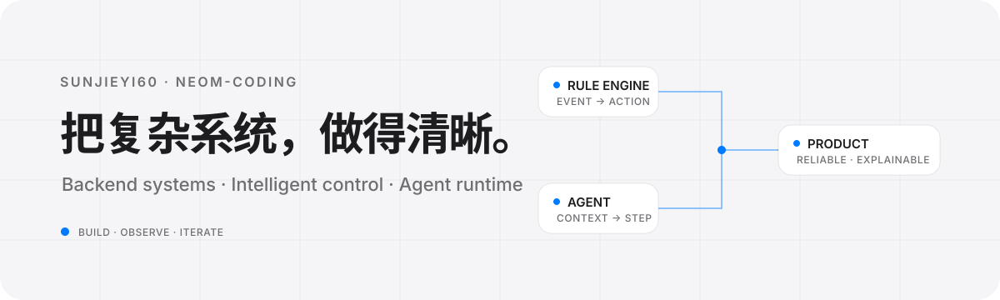

<div align="center">
  
</div>

## 你好，我是 sunjieyi60

我在做面向真实场景的系统工程：把设备、规则、数据与人的操作连接起来，并让复杂流程保持可理解、可观测、可演进。

目前主要维护 [NeoM-Coding](https://github.com/NeoM-Coding)，工作重心集中在 **实验室设备管理与智能控制**，以及 **用户引导与 Agent Runtime**。我喜欢从领域模型和系统边界出发，把原型一路推进到能够稳定运行的产品。

### 现在专注于

- **智能控制与规则系统**：事件驱动的规则执行、表达式森林、设备状态同步与告警动作。
- **可靠的分布式后端**：权限关系、异步 RPC、事务边界、链路追踪与慢查询优化。
- **Agent 与产品交互**：语义运行时、上下文压缩、渐进执行反馈，以及跨框架的产品引导。
- **从后端到界面的完整交付**：让管理、教务 BI 与实时控制能力在前端保持清晰、一致。

## 代表项目

<table>
  <tr>
    <td width="50%" valign="top">
      <h3><a href="https://github.com/NeoM-Coding/Labsystem">Labsystem</a></h3>
      <p>面向实验室的设备管理与远程控制平台。围绕规则引擎、权限关系、教务数据、可观测性与可靠部署持续演进。</p>
      <p><code>Java</code> <code>Domain-Driven Design</code> <code>Rule Engine</code> <code>OpenTelemetry</code> <code>MQTT</code></p>
    </td>
    <td width="50%" valign="top">
      <h3><a href="https://github.com/NeoM-Coding/Labsystem-Web">Labsystem Web</a></h3>
      <p>实验室平台的 Web 工作台，覆盖设备实时控制、智能策略、权限配置、教务排课与数据分析。</p>
      <p><code>TypeScript</code> <code>React</code> <code>Realtime UI</code> <code>BI</code></p>
    </td>
  </tr>
  <tr>
    <td colspan="2" valign="top">
      <h3><a href="https://github.com/NeoM-Coding/Actour">Actour</a></h3>
      <p>用户引导与产品漫游引擎。近期正在探索由 Agent 驱动的渐进式操作、统一语义运行时、执行历史调试与低成本上下文管理。</p>
      <p><code>TypeScript</code> <code>Agent Runtime</code> <code>Product Tour</code> <code>React Native</code> <code>Taro</code></p>
    </td>
  </tr>
</table>

## 工程取向

```text
Clear boundaries  →  Observable behavior  →  Reliable delivery
清晰的边界           可观测的行为             可靠的交付
```

我关注的不只是功能是否完成，也关注系统在真实使用中的反馈：状态能否追踪、错误能否定位、权限能否解释、交互能否让人预期下一步。比起堆叠技术名词，我更在意每个选择是否真正降低了系统的长期复杂度。

## 技术地图

**主要语言**


**系统与交付**


## 最近的探索

- 为 Agent Runtime 压缩上下文，让 ReAct 执行减少不必要的 token 支出。
- 将产品引导与 Agent 遮罩定位统一，并补充定位检查和渐进执行反馈。
- 为规则执行与 MQTT 链路建立可复用的 tracing 边界和异步上下文传播。
- 持续学习 Rust，并通过 [LearningOS](https://github.com/LearningOS) 课程补足系统编程基础。

---

<p align="center">
  <a href="https://github.com/NeoM-Coding">NeoM-Coding</a>
  &nbsp;·&nbsp;
  <a href="https://github.com/sunjieyi60?tab=repositories">全部仓库</a>
  &nbsp;·&nbsp;
  <a href="https://sunjieyi60.github.io">个人站点</a>
</p>
